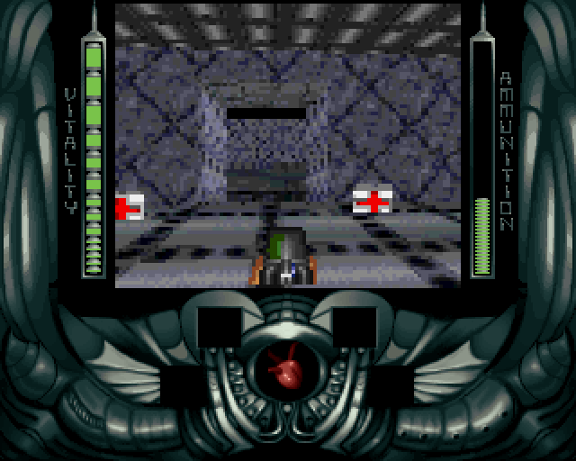

# Alien Breed 3D — portage Java

Portage en Java du moteur d'**Alien Breed 3D** (Team17, 1995), transcrit
ligne à ligne depuis l'assembleur 68000 d'origine.


Le rendu est un rasteriseur logiciel qui reproduit l'arithmétique du 68000 :
mêmes divisions entières, mêmes débordements, même ordre de dessin.
jMonkeyEngine n'ouvre que la fenêtre, lit le clavier et affiche une texture ;
il ne dessine rien lui-même. Les données du jeu d'origine sont lues telles
quelles à l'exécution — aucune conversion hors ligne.

| | |
|---|---|
|  |  |

## Ce qui tourne

Écran-titre en fondu, menu avec mot de passe et reconfiguration des touches,
rendu logiciel complet (murs, sols, plafonds, sprites, arme en main, fond de
ciel, eau), bandeau et jauges, portes, ascenseurs, interrupteurs, clés et
conditions, ramassages, tous les ennemis que posent les seize niveaux — qui
rôdent, repèrent, poursuivent, mordent, tirent, sèment ou crachent du feu —, six
armes dont trois à projectiles, explosions avec souffle et éclats, barils, le son, la fin de niveau avec son mot de passe, et le
lecteur de modules ProTracker.

Un niveau se termine quand le joueur entre dans une salle précise — `ENDZONES`
en donne une par niveau, et c'est là toute la condition de victoire. Gagner
ajoute un au niveau maximum et écrit le mot de passe suivant sur la ligne du
menu ; perdre laisse cette ligne intacte, ce qui interdit de gagner un mot de
passe en mourant.

## Faire tourner

Il faut **les deux disquettes du jeu** (`.adf`), et rien d'autre.

Elles portent les seize niveaux, les sons, les seize feuilles de sprites, les
quatorze textures de murs, les carreaux de sol et l'écran-titre : quarante-cinq
des soixante-dix fichiers que le moteur ouvre, 501 Ko.

Les vingt-deux autres — table des sinus, fond de ciel, bandeau et ses bordures,
police du menu, palettes, tables d'ombrage et d'eau, icônes de clés, les trois
modules de musique — n'ont jamais été sur une disquette : l'exécutable Amiga les
avait compilés dedans avec `INCBIN`. Ce dépôt les porte donc lui-même, 307 Ko
dans `src/main/resources/ab3d/includes/`. Deux de plus sont **calculés** plutôt
que livrés, et deux ne sont nulle part (`uglymonster`, qu'aucun niveau ne place).

L'arbre des sources publié par Team17 n'est plus nécessaire pour jouer. Il reste
utile pour les contrôles de conformité, qui comparent le portage à l'assembleur,
et `gradle tool -Ptool=DiskCoverCheck` refait ce compte lui-même à tout moment.

Depuis un checkout :

```
gradle run -Dab3d.disk=../adf-extract
```

### Application autonome

```
gradle jpackage
```

produit dans `build/dist/` une application avec sa propre JVM, qui n'exige rien
d'installé. Au premier lancement elle demande les deux disquettes, les extrait
elle-même (le lecteur ADF gère OFS et FFS) et retient la réponse dans
`~/.ab3d-java`. Les lancements suivants démarrent directement.

Deux routes pour les disquettes : indiquer tes propres fichiers `.adf`, ou les
prendre sur **Dream17**, l'archive de préservation Amiga, qui les sert toutes
les deux dans un même fichier. Rien n'est téléchargé sans que le choix soit
fait.

`-Ppackage=msi` (ou `deb`, `dmg`) produit un installeur natif à la place, si les
outils correspondants sont présents.

### Commandes

Ce sont celles de `CONTROLBUFFER`, pas un schéma moderne, et elles sont
reconfigurables depuis **CONTROL OPTIONS**.

| Touche | Action |
|---|---|
| Flèches ← → | tourner |
| Flèches ↑ ↓ | avancer, reculer |
| `.` `/` | pas de côté |
| Maj droite | courir |
| Alt droit | tirer |
| Espace | portes, ascenseurs, interrupteurs |
| `D` | s'accroupir |
| `L` | regarder derrière |
| `1`–`5` | fusil à impulsion, à pompe, plasma, grenades, roquettes |

Le joueur a l'inertie de l'original : `PLR1_keyboard_control` tourne dans
l'interruption verticale, cinquante fois par seconde, où les touches poussent
une vitesse qui perd un huitième d'elle-même à chaque tic — on accélère, on
glisse, on tourne avec du jeu. La boucle principale prend ce qui s'est
accumulé et le fait passer dans les murs ; une image sans tic ne fait que
redessiner, et les autres donnent leur nombre de tics comme `TempFrames`. Une
porte s'ouvre quand on tape Espace pendant que le joueur la touche, c'est-à-dire
en marchant dedans ou dans le court élan qui suit.

Pour changer de niveau, **PASSWORD** dans le menu. Les disquettes portent les
**seize** niveaux, et tous se chargent :

| | | | |
|---|---|---|---|
| 1 The Gate `KLLKFFFFFFFFFFFF` | 2 Storage Bay `KOLKFNFFFFFFFFFF` | 3 Sewer Network `OKLKFHFFFFFFFFFF` | 4 The Courtyard `KPLKFPFFFFFFFFFF` |
| 5 System Purge `PLOPNFFFFFFFFFFF` | 6 The Mines `POOPNNFFFFFFFFFF` | 7 The Furnace `KKLKNHFFFFFFFFFF` | 8 Test Arena Gamma `PPOPNPFFFFFFFFFF` |
| 9 Surface Zone `LLLKHFFFFFFFFFFF` | 10 Training Area `LOLKHNFFFFFFFFFF` | 11 Admin Block `PKLKHHFFFFFFFFFF` | 12 The Pit `LPLKHPFFFFFFFFFF` |
| 13 Strata `OLLKPFFFFFFFFFFF` | 14 Reactor Core `OOLKPNFFFFFFFFFF` | 15 Cooling Tower `LKLKPHFFFFFFFFFF` | 16 Command Centre `OPLKPPFFFFFFFFFF` |



## Le build visé

Le main est **`source/jg.s`**, pas `master.s`. La distinction a compté : sur
les 778 routines que les deux fichiers partagent, 183 diffèrent, et une
quarantaine touchaient au portage — décalages de tuiles, tests de bits contre
comparaisons, sol de Gouraud présent dans l'un et absent de l'autre. Tout ce qui
est transcrit vient de l'arbre d'inclusion de `jg.s`.

## Comment le code est écrit

Chaque routine porte le nom de son original et cite les instructions qui
décident quelque chose. `M68k` fournit les primitives — `divs` qui laisse sa
destination inchangée en cas de débordement, `muls`, `swap`, l'extension de
signe — parce que reproduire ces cas-là est souvent la différence entre une
image juste et une image plausible.

Les tables ne sont pas recopiées à la main : elles sont **parsées depuis
l'assembleur**. Les animations d'armes, la table des collisions, les
enregistrements d'armes, les écrans de menu, les noms des échantillons, les
touches par défaut — tout vient de `source/`. Deux entrées de la table des sons
sont commentées ; une recopie à la main aurait décalé d'un cran tout ce qui suit
la dixième.

Ce que ces parseurs trouvent est ensuite **écrit une fois pour toutes** dans
`ab3d/gen/Tables.java` par `gradle tool -Ptool=TableGen`. Les parseurs restent ce
qui décide ; le fichier généré n'est que leur réponse, gardée, pour que l'arbre
des sources ne soit plus nécessaire à ça. `TableCheck` charge chaque table des
deux façons et compare, ce qui est la seule chose qui rend l'opération sûre.

Trois choses de plus sont **calculées au lieu d'être lues**, et chacune a son
contrôle qui la tient à l'octet près contre le fichier d'origine :

| ce qui n'est plus livré | la règle | le contrôle |
| --- | --- | --- |
| `xtocopx` (192 o) | `(colonne + colonne/32) × 4` — la copper list saute une paire `$106` toutes les 32 couleurs | `BuiltTableCheck` |
| `iterfile` (2 Ko) | la plus petite puissance de deux ≥ n, et son masque | `BuiltTableCheck` |
| les quatorze nuances de chaque `.pal` (13 Ko) | `v × (15 − nuance) / 15`, la dernière nuance au noir | `ShadeCheck` |

La règle d'ombrage n'a pas été devinée : les quatorze palettes de l'arbre
donnent 6 720 échantillons de « cette composante à cette nuance devient celle-là »
et **aucun ne contredit un autre**. Seules les trente-deux couleurs du haut de
chaque palette sont gardées.

## Les contrôles de conformité

`src/main/java/ab3d/tools/` contient une cinquantaine de programmes qui vérifient
le portage contre la source, sans ouvrir de fenêtre :

```
gradle tool -Ptool=EnemyCheck
gradle tool -Ptool=PasswordCheck
```

Ils cherchent des accords entre deux endroits écrits séparément. Les douze
touches par défaut existent deux fois dans l'original — comme octets dans
`CONTROLBUFFER` et comme libellés imprimés sur l'écran des contrôles — et les
douze concordent. Les huit listes d'animation d'armes font chacune exactement un
de plus que le compte annoncé ailleurs dans la table. Vingt-sept des vingt-huit
échantillons ont la longueur que la table leur donne.

Le même travail a servi à savoir quoi **ne pas** porter : il n'y a aucun mur
transparent dans les seize niveaux ; le visage animé du bandeau a ses données
commentées et sa routine jamais appelée.

Il a aussi servi à se tromper, et c'est instructif. Le recensement des ennemis
ne regardait que les quatre premiers niveaux, et concluait que six types sur
douze n'étaient posés nulle part. Sur les seize, `EnemyCensus` en trouve
onze : 49 vers, 34 conduites de gaz, 10 arbres, un robot (niveau 8) et la
grosse chose rouge, seule, au bout du niveau 16. Seul l'œil n'est jamais posé —
ce sont les arbres qui le sèment.

Les contrôles de `tools/` prennent donc désormais par défaut tous les niveaux
des disquettes (`Levels.all()`). Repassés sur les seize, ils tiennent : aucun
point ne sort de sa salle, les 40 clés se ramassent et ouvrent chacune une
porte, chaque condition qu'une porte attend sans qu'un interrupteur la donne est
un bit de clé — le niveau 16 attend le bit 3, et c'est la grosse chose rouge
qui le donne en mourant. Trois contrôles se trompaient eux-mêmes et ont été
corrigés : l'un mettait toujours le joueur au rez-de-chaussée (une clé du
niveau 8 est à l'étage), un autre ignorait l'armure des nouveaux ennemis, le
troisième lisait la taille d'un enregistrement de sol avant qu'elle soit
renseignée. Une seule bizarrerie vient des données : au niveau 12, dix listes
de découpage nomment le point 0, que la salle ne fait pas tourner — l'original
lit alors une position restée de l'image précédente, et le portage aussi.

### Les ennemis des niveaux 5 à 16

| type | fichier | ce qu'il fait |
| --- | --- | --- |
| 13 ver | `halfworm.s` | se tourne vers le joueur sans bouger, quatre tirs de plasma depuis sa gueule (`SHOTOFFMULT` 700), une armure qui divise chaque coup par quatre ; laisse toujours son corps |
| 16 arbre | `tree.s` | ne tire pas : prend un enregistrement libre de `OtherNastyData` et y fait naître un œil ; les coups de moins de quatre ne comptent pas mais s'additionnent ; disparaît à sa mort |
| 17 œil | `EyeBall.s` | `FlyingScalyBall.s` dessiné depuis la planche de l'arbre ; éclate en dix morceaux quoi qu'il arrive |
| 14 grosse chose rouge | `bigredthing.s` | roquettes deux par deux depuis son bras ; tuée, elle **devient une clé** (condition bit 3) dans son propre enregistrement |
| 20 conduite de gaz | `anims` | ni vue ni blessable : cinq bouffées de flamme à dix images d'écart, puis le repos que `ObjTimer` donne à chaque conduite |
| 6 robot | `robot.s` | un modèle 3D qui garde un cap et braque vers lui, grenades par deux face au joueur, armure de quatre bits ; explose et devient une clé |

`OtherNastyData` est une troisième réserve de vingt enregistrements que l'en-tête
du niveau ne nomme pas : `jg.s` la trouve par `add.l #64*20,a2` après les tirs
ennemis. `PoolProbe` montre qu'elle est, dans les seize niveaux, à l'intérieur de
la liste d'objets, juste avant les deux joueurs. `NewEnemyCheck` fait vivre
chacun de ces types devant le joueur et vérifie ce qu'il laisse en mourant.

## Les bizarreries de l'original, gardées et signalées

Le code note ce qu'il trouve plutôt que de le lisser.

- `CALCPASSWORD` teste quatre armes avec quatre `sne d0` de suite, et `sne`
  écrit l'octet entier : chaque test efface le précédent. Un mot de passe donné
  par le jeu ne peut jamais restituer plus que la dernière arme, alors que
  `GETSTATS` en relit quatre.
- `ComputeBlast` écrit `add.w 32,d3` sans `#` : lu à la lettre, c'est le mot à
  l'adresse absolue 32, et l'atténuation du souffle disparaîtrait.
- Le bloc qui calcule la hauteur au franchissement d'une ligne soustrait `a4`,
  qui est le pointeur de la zone de destination depuis le haut de la boucle.
- La musique de fond ne démarre jamais : la boucle n'appelle le lecteur que si
  l'octet 3 de `Prefsfile` vaut `'b'`, et il s'assemble à `'k4nx'`. Les deux
  jingles de fin de niveau ne sont pas conditionnés, et sont donc la seule
  musique que ce build joue.

## Ce que le jeu montrait de travers, et pourquoi

Une partie jouée de bout en bout a montré quatre défauts que les contrôles ne
voyaient pas. `FlickerHunt` fait maintenant marcher le joueur dans un niveau et
signale les images qui jurent avec leurs voisines.

- **Les murs vus de biais en peigne.** `CalcAndDraw` lit la luminosité d'une
  extrémité par `sub.w #300,d5 / ext.w d5` : l'octet bas seulement. La
  subdivision fait la moyenne de la colonne de texture et de la luminosité en
  un seul mot long, si bien qu'une somme de colonnes impaire laisse tomber son
  bit dans le bit quinze de la luminosité ; le `ext.w` le jette. Le portage
  avait la soustraction sans le `ext.w`, et le dégradé faisait le tour du
  nuancier toutes les deux ou trois colonnes.
- **L'écran qui disparaît une image.** Un point presque à la hauteur de l'œil
  et loin sur le côté fait déborder `divs` ; le 68000 laisse alors le dividende
  tel quel, la colonne devient un reste sans rapport, et le mur qui y touche est
  jeté entier. **L'original le fait aussi** ; le portage pousse désormais la
  colonne du côté où est le point (`Renderer68k.CLAMP_OVERFLOW`).
- **Les barils blancs.** `BARREL.pal` s'appelle `barrel.pal-0` dans l'arbre
  source, et une couleur absente s'écrivait `$fff`.
- **Les ennemis qui ne meurent pas.** `Collision` n'était pas portée : rien ne
  tenait un alien à distance, et à moins de quatre-vingts unités la visée
  l'écarte (l'écart de hauteur sur quarante-quatre dépasse le double de la
  distance). Il venait mordre là où on ne pouvait pas le toucher. Avec
  `Collision`, une salle de quatre aliens tombe en douze tirs, tous au but, au
  lieu de quatre-vingts tirs pour deux touches. Les ennemis prenaient aussi
  leurs marches avec la hauteur du joueur au lieu de la leur.

- **Des murs aux mauvaises textures, un peu partout.** La table des textures
  de murs n'était connue que pour ses six premières entrées, celles que
  `master.s` déclare ; les suivantes avaient été devinées d'après les fichiers
  assez grands pour les bandes que les niveaux demandent. Or `jg.s` inclut
  `wallchunk.s`, qui donne la liste entière : quatre devinettes étaient fausses
  (6, 8, 9 et 13), et une texture de la mauvaise taille sort en bouillie.
- **Le mouvement saccadé.** Le jeu avance cinquante fois par seconde, l'écran
  en affiche soixante : une image sur six ne bougeait pas. L'affichage place
  maintenant l'œil entre les deux derniers tics ; tout ce qui décide de quelque
  chose garde les positions des tics.
- **Le rectangle rayé multicolore (indicateurs de clé), l'eau, le menu.**
  L'exécutable de la disquette un, `abd.pk`, comparé octet par octet aux
  sources une fois décompressé, contient les mêmes modèles et presque les mêmes
  tables, sauf trois : `Texturemaps` (les textures des objets 3D ; celle des
  sources est une version antérieure, bruitée, et le boîtier des indicateurs y
  est une bouillie rayée), `brightentab` (le jeu a celle que les sources
  appellent `oldbrightenfile`, des couleurs douze bits ; `brightenfile` est une
  table d'octets d'une autre version, et lue en mots elle teintait l'eau
  n'importe comment) et `optcop` (le texte du menu est doré dans le jeu, gris
  dans les sources). `data/ShippedExe` transcrit le décompresseur de
  l'exécutable et y lit ces trois tables ; `tools/ShippedExeCheck` vérifie que
  leurs voisines sont bien identiques aux fichiers des sources, ce qui garantit
  les adresses. Sans la disquette, le portage retombe sur les sources et le dit.
- **Les objets 3D qui flottent, le fusil à pompe trop haut.** Le centre
  horizontal d'un modèle se lit dans `ObjRotated` au long de l'octet quatre (x
  déjà multiplié par 128) ; le portage prenait le mot de l'octet zéro (x brut),
  si bien que chaque modèle se dessinait presque au milieu de la vue au lieu
  d'être sur son mur. Et `GUNYOFFS` avait été recopié avec un zéro pour le
  fusil à pompe au lieu de vingt : il est désormais lu dans `jg.s`.

Et deux tremblements venaient du glissement contre les murs : pressé dans un
coin, le joueur était renvoyé en arrière une image sur deux. Un déplacement qui
finit derrière son point de départ est désormais refusé
(`Player.REFUSE_BACKSLIDE`), comme l'est déjà celui qui sort de toute salle.

## Ce qui manque

Le mode deux joueurs, et le grand alien laid (`BigUglyAlien.s`), inclus mais
qu'aucun type ne fait appeler.

Trois écarts assumés subsistent dans le moteur, tous commentés à l'endroit
où ils sont : un refus de déplacement qui n'existe pas dans l'original, parce que
le glissement transcrit laisse un résidu que le sien n'a pas ; le ver, l'arbre et la grosse chose rouge qui, en attaquant, gardent la salle où
ils sont — l'original appelle `MoveObject`, remet l'ancienne position, mais
garde la salle d'arrivée ; et `FindCloseRoom` (`CloseRoom`), qui choisit dans
quelle salle dessiner un grand sprite à cheval sur deux, et qui lance sa seconde
sonde depuis la salle de la créature et non depuis celle où la première s'est
arrêtée, et l'arrêt au premier mur garde le point glissé plutôt que de
calculer le point d'impact.

## Licence

Le code de ce dépôt est publié tel quel.

`src/main/resources/ab3d/includes/` contient 307 Ko de données d'origine de
**Team17**, tirées des sources publiées : les tables que l'exécutable Amiga avait
compilées dedans. Le portage ne s'en sert plus qu'en secours : il lit ces tables
dans l'exécutable de la disquette un (`abd.pk`, voir `data/ShippedExe`), car
trois d'entre elles n'existent dans les sources que dans une autre version. Ils restent la propriété de leurs
ayants droit, comme tout le reste du contenu du jeu.

Les niveaux, les sons, les sprites et les textures ne sont **pas** dans ce
dépôt : il faut posséder une copie d'Alien Breed 3D pour faire tourner ce
portage.
