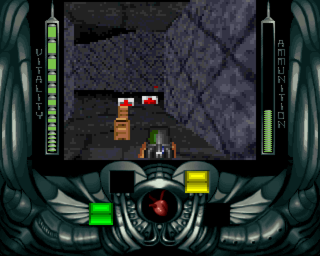
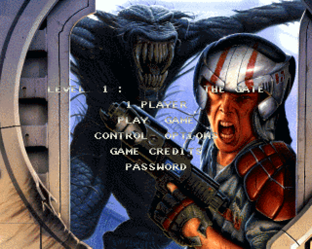
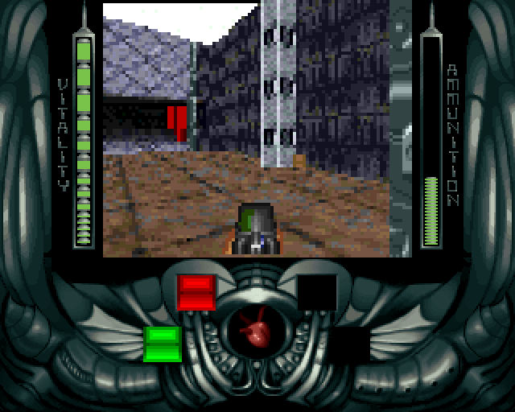

# Alien Breed 3D — Java Port

*[Version française](README_fr.md)*

A Java port of the **Alien Breed 3D** engine (Team17, 1995), transcribed
line by line from the original 68000 assembly.



Rendering is a software rasteriser that reproduces the 68000's arithmetic:
same integer divisions, same overflows, same drawing order.
jMonkeyEngine only opens the window, reads the keyboard and displays a texture;
it draws nothing itself. The original game data is read as is at run time —
no offline conversion.

| | |
|---|---|
|  |  |

## What runs

Fading title screen, menu with password and key remapping, full software
rendering (walls, floors, ceilings, sprites, gun in hand, sky backdrop,
water), status bar and gauges, doors, lifts, switches, keys and conditions,
pickups, every enemy the sixteen levels place — prowling, spotting, chasing,
biting, shooting, spawning or breathing fire —, six weapons, three of them
firing projectiles, explosions with blast and debris, barrels, sound, the end
of level with its password, and the ProTracker module player.

A level ends when the player enters a specific room — `ENDZONES` gives one per
level, and that is the whole victory condition. Winning adds one to the maximum
level and writes the next password on the menu line; losing leaves that line
untouched, so a password cannot be earned by dying.

## Running it

You need **the game's two disks** (`.adf`), and nothing else.

They hold the sixteen levels, the sounds, the sixteen sprite sheets, the
fourteen wall textures, the floor tiles and the title screen: forty-five of
the seventy files the engine opens, 501 KB.

The other twenty-two — sine table, sky backdrop, status bar and its borders,
menu font, palettes, shading and water tables, key icons, the three music
modules — were never on a disk: the Amiga executable had them compiled in with
`INCBIN`. This repository therefore carries them itself, 307 KB in
`src/main/resources/ab3d/includes/`. Two more are **computed** rather than
shipped, and two are nowhere (`uglymonster`, which no level places).

The source tree published by Team17 is no longer needed to play. It remains
useful for the conformance checks, which compare the port with the assembly,
and `gradle tool -Ptool=DiskCoverCheck` redoes this count itself at any time.

From a checkout:

```
gradle run -Dab3d.disk=../adf-extract
```

### Standalone application

```
gradle jpackage
```

produces in `build/dist/` an application with its own JVM, which requires
nothing installed. On first launch it asks for the two disks, extracts them
itself (the ADF reader handles OFS and FFS) and remembers the answer in
`~/.ab3d-java`. Later launches start straight away.

Two routes for the disks: point to your own `.adf` files, or fetch them from
**Dream17**, the Amiga preservation archive, which serves both in a single
file. Nothing is downloaded until the choice is made.

`-Ppackage=msi` (or `deb`, `dmg`) produces a native installer instead, if the
matching tools are present.

### Controls

These are the ones from `CONTROLBUFFER`, not a modern scheme, and they can be
remapped from **CONTROL OPTIONS**.

| Key | Action |
|---|---|
| Arrows ← → | turn |
| Arrows ↑ ↓ | forward, back |
| `.` `/` | sidestep |
| Right Shift | run |
| Right Alt | fire |
| Space | doors, lifts, switches |
| `D` | crouch |
| `L` | look behind |
| `1`–`5` | pulse rifle, shotgun, plasma, grenades, rockets |

The player has the original's inertia: `PLR1_keyboard_control` runs in the
vertical blank interrupt, fifty times a second, where the keys push a speed
that loses an eighth of itself on every tick — you accelerate, you slide, you
turn with some play. The main loop takes what has built up and moves it
through the walls; a frame with no tick only redraws, and the others pass
their tick count as `TempFrames`. A door opens when you press Space while the
player is touching it, that is, walking into it or in the short momentum that
follows.

To change level, **PASSWORD** in the menu. The disks hold the **sixteen**
levels, and all of them load:

| | | | |
|---|---|---|---|
| 1 The Gate `KLLKFFFFFFFFFFFF` | 2 Storage Bay `KOLKFNFFFFFFFFFF` | 3 Sewer Network `OKLKFHFFFFFFFFFF` | 4 The Courtyard `KPLKFPFFFFFFFFFF` |
| 5 System Purge `PLOPNFFFFFFFFFFF` | 6 The Mines `POOPNNFFFFFFFFFF` | 7 The Furnace `KKLKNHFFFFFFFFFF` | 8 Test Arena Gamma `PPOPNPFFFFFFFFFF` |
| 9 Surface Zone `LLLKHFFFFFFFFFFF` | 10 Training Area `LOLKHNFFFFFFFFFF` | 11 Admin Block `PKLKHHFFFFFFFFFF` | 12 The Pit `LPLKHPFFFFFFFFFF` |
| 13 Strata `OLLKPFFFFFFFFFFF` | 14 Reactor Core `OOLKPNFFFFFFFFFF` | 15 Cooling Tower `LKLKPHFFFFFFFFFF` | 16 Command Centre `OPLKPPFFFFFFFFFF` |


## The target build

The main file is **`source/jg.s`**, not `master.s`. The distinction mattered:
of the 778 routines the two files share, 183 differ, and some forty affected
the port — tile offsets, bit tests versus comparisons, a Gouraud floor present
in one and missing from the other. Everything transcribed comes from the
include tree of `jg.s`.

## How the code is written

Each routine bears the name of its original and quotes the instructions that
decide something. `M68k` provides the primitives — `divs` that leaves its
destination unchanged on overflow, `muls`, `swap`, sign extension — because
reproducing those cases is often the difference between a correct image and a
plausible one.

The tables are not copied by hand: they are **parsed from the assembly**.
Weapon animations, the collision table, weapon records, menu screens, sample
names, default keys — everything comes from `source/`. Two entries of the sound
table are commented out; a hand copy would have shifted everything after the
tenth by one.

What these parsers find is then **written once and for all** to
`ab3d/gen/Tables.java` by `gradle tool -Ptool=TableGen`. The parsers remain
what decides; the generated file is only their answer, kept, so that the source
tree is no longer needed for that. `TableCheck` loads each table both ways and
compares them, which is the only thing that makes the operation safe.

Three more things are **computed instead of read**, and each has its check
that holds it byte for byte against the original file:

| what is no longer shipped | the rule | the check |
| --- | --- | --- |
| `xtocopx` (192 B) | `(column + column/32) × 4` — the copper list skips a `$106` pair every 32 colours | `BuiltTableCheck` |
| `iterfile` (2 KB) | the smallest power of two ≥ n, and its mask | `BuiltTableCheck` |
| the fourteen shades of each `.pal` (13 KB) | `v × (15 − shade) / 15`, the last shade to black | `ShadeCheck` |

The shading rule was not guessed: the tree's fourteen palettes give 6,720
samples of "this component at this shade becomes that one" and **none
contradicts another**. Only the top thirty-two colours of each palette are
kept.

## Conformance checks

`src/main/java/ab3d/tools/` holds some fifty programs that check the port
against the source, without opening a window:

```
gradle tool -Ptool=EnemyCheck
gradle tool -Ptool=PasswordCheck
```

They look for agreement between two places written separately. The twelve
default keys exist twice in the original — as bytes in `CONTROLBUFFER` and as
labels printed on the controls screen — and all twelve match. The eight weapon
animation lists are each exactly one longer than the count given elsewhere in
the table. Twenty-seven of the twenty-eight samples have the length the table
gives them.

The same work told what **not** to port: there is no transparent wall in the
sixteen levels; the status bar's animated face has its data commented out and
its routine never called.

It also served to be wrong, which is instructive. The enemy census only looked
at the first four levels, and concluded that six types out of twelve were
placed nowhere. Over all sixteen, `EnemyCensus` finds eleven: 49 worms, 34 gas
pipes, 10 trees, one robot (level 8) and the big red thing, alone, at the end of
level 16. Only the eye is never placed — the trees spawn it.

The checks in `tools/` therefore now take every level on the disks by default
(`Levels.all()`). Rerun over all sixteen, they hold: no point leaves its room,
the 40 keys can be picked up and each opens a door, every condition a door
waits for without a switch giving it is a key bit — level 16 waits for bit 3,
and the big red thing gives it when it dies. Three checks were themselves
wrong and have been fixed: one always put the player on the ground floor (a key
in level 8 is upstairs), another ignored the new enemies' armour, the third
read the size of a floor record before it was set. Only one quirk comes from
the data: in level 12, ten clip lists name point 0, which the room does not
rotate — the original then reads a position left over from the previous frame,
and so does the port.

### The enemies of levels 5 to 16

| type | file | what it does |
| --- | --- | --- |
| 13 worm | `halfworm.s` | turns towards the player without moving, four plasma shots from its mouth (`SHOTOFFMULT` 700), armour that divides every hit by four; always leaves its body |
| 16 tree | `tree.s` | does not shoot: takes a free record from `OtherNastyData` and spawns an eye in it; hits below four do not count but add up; vanishes when it dies |
| 17 eye | `EyeBall.s` | `FlyingScalyBall.s` drawn from the tree's sheet; bursts into ten pieces whatever happens |
| 14 big red thing | `bigredthing.s` | rockets two by two from its arm; once killed, it **becomes a key** (condition bit 3) in its own record |
| 20 gas pipe | `anims` | neither seen nor hurt: five puffs of flame ten frames apart, then the rest `ObjTimer` gives each pipe |
| 6 robot | `robot.s` | a 3D model that holds a heading and steers towards it, grenades two at a time facing the player, four-bit armour; explodes and becomes a key |

`OtherNastyData` is a third pool of twenty records that the level header does
not name: `jg.s` finds it with `add.l #64*20,a2` after the enemy shots.
`PoolProbe` shows that, in all sixteen levels, it lies inside the object list,
just before the two players. `NewEnemyCheck` brings each of these types to life
in front of the player and checks what it leaves when it dies.

## The original's quirks, kept and flagged

The code notes what it finds rather than smoothing it over.

- `CALCPASSWORD` tests four weapons with four `sne d0` in a row, and `sne`
  writes the whole byte: each test erases the previous one. A password given
  by the game can never restore more than the last weapon, although
  `GETSTATS` reads four back.
- `ComputeBlast` writes `add.w 32,d3` without `#`: taken literally, that is the
  word at absolute address 32, and the blast falloff would disappear.
- The block that computes the height when crossing a line subtracts `a4`,
  which has been the destination zone pointer since the top of the loop.
- The background music never starts: the loop only calls the player if byte 3
  of `Prefsfile` is `'b'`, and it assembles to `'k4nx'`. The two end-of-level
  jingles are not conditional, and are therefore the only music this build
  plays.

## What the game showed wrong, and why

A game played from start to finish showed four defects the checks did not
see. `FlickerHunt` now walks the player through a level and flags the frames
that clash with their neighbours.

- **Walls seen at an angle, combed.** `CalcAndDraw` reads an end's brightness
  with `sub.w #300,d5 / ext.w d5`: the low byte only. Subdivision averages the
  texture column and the brightness in a single long word, so an odd column sum
  drops its bit into bit fifteen of the brightness; the `ext.w` throws it away.
  The port had the subtraction without the `ext.w`, and the gradient went round
  the shade table every two or three columns.
- **The screen vanishing for a frame.** A point almost at eye height and far to
  the side makes `divs` overflow; the 68000 then leaves the dividend as is, the
  column becomes an unrelated remainder, and the wall touching it is discarded
  whole. **The original does it too**; the port now pushes the column towards
  the side the point is on (`Renderer68k.CLAMP_OVERFLOW`).
- **White barrels.** `BARREL.pal` is called `barrel.pal-0` in the source tree,
  and a missing colour was written as `$fff`.
- **Enemies that would not die.** `Collision` had not been ported: nothing kept
  an alien at a distance, and under eighty units the aim misses it (the height
  difference over forty-four exceeds twice the distance). It came to bite where
  it could not be hit. With `Collision`, a room of four aliens falls in twelve
  shots, all on target, instead of eighty shots for two hits. Enemies also took
  their steps with the player's height instead of their own.

- **Walls with the wrong textures, here and there.** The wall texture table
  was only known for its first six entries, the ones `master.s` declares; the
  next ones had been guessed from the files large enough for the strips the
  levels ask for. But `jg.s` includes `wallchunk.s`, which gives the whole
  list: four guesses were wrong (6, 8, 9 and 13), and a texture of the wrong
  size comes out as mush.
- **Jerky movement.** The game advances fifty times a second, the screen shows
  sixty: one frame in six did not move. The display now places the eye between
  the last two ticks; everything that decides something keeps the tick
  positions.
- **The multicoloured striped rectangle (key indicators), the water, the
  menu.** The executable on disk one, `abd.pk`, compared byte for byte with the
  sources once decompressed, contains the same models and almost the same
  tables, except three: `Texturemaps` (the 3D objects' textures; the sources'
  one is an earlier, noisy version, and the indicators' housing is striped mush
  in it), `brightentab` (the game has the one the sources call
  `oldbrightenfile`, twelve-bit colours; `brightenfile` is a byte table from
  another version, and read as words it tinted the water any old way) and
  `optcop` (the menu text is gold in the game, grey in the sources).
  `data/ShippedExe` transcribes the executable's decompressor and reads these
  three tables from it; `tools/ShippedExeCheck` checks that their neighbours
  are identical to the source files, which guarantees the addresses. Without
  the disk, the port falls back on the sources and says so.
- **3D objects floating, the shotgun too high.** A model's horizontal centre is
  read in `ObjRotated` as the long at byte four (x already multiplied by 128);
  the port took the word at byte zero (raw x), so every model was drawn almost
  in the middle of the view instead of on its wall. And `GUNYOFFS` had been
  copied with a zero for the shotgun instead of twenty: it is now read from
  `jg.s`.

And two jitters came from sliding along walls: pressed into a corner, the
player was pushed back every other frame. A move that ends behind its starting
point is now refused (`Player.REFUSE_BACKSLIDE`), as one that leaves every
room already is.

## What is missing

Two-player mode, and the big ugly alien (`BigUglyAlien.s`), included but called
by no type.

Three deliberate deviations remain in the engine, all commented where they
are: a refused move that does not exist in the original, because the
transcribed sliding leaves a residue the original's does not; the worm, the
tree and the big red thing which, when attacking, keep the room they are in —
the original calls `MoveObject`, restores the old position, but keeps the
arrival room; and `FindCloseRoom` (`CloseRoom`), which chooses in which room to
draw a large sprite straddling two, and which launches its second probe from
the creature's room and not from the one where the first stopped, and the stop
at the first wall keeps the slid point rather than computing the point of
impact.

## Legal Notice & Game Assets

### Independent Engine Implementation

This project is an independent reimplementation of the *Alien Breed 3D* engine, designed to reproduce the original game's behavior on modern platforms.

The engine has been developed from the original source code (68000 assembly), released together with that of *Alien Breed 3D II* and available in [mheyer32/ab3d-rtg](https://github.com/mheyer32/ab3d-rtg), through technical analysis and compatibility testing. That source code is not included in this repository.

### Original Game Files

This project requires original game files, the two Amiga ADF disk images, to run.

**Original game files are not included in this project.** Levels, sounds, sprites and textures are not here: you need to own a copy of Alien Breed 3D to run this port.

Users must obtain and provide their own game files from a legally authorized source. Before downloading or using this engine, users are required to confirm that they possess a legally obtained copy of the original game.

The only exception: `src/main/resources/ab3d/includes/` contains 307 KB of original **Team17** data, taken from the published sources: the tables the Amiga executable had compiled in (`INCBIN`), which are on no disk. The port now only uses them as a fallback: it reads these tables from the executable on disk one (`abd.pk`, see `data/ShippedExe`), because three of them exist in the sources only in another version.

Eloane Studio does not host, distribute, or provide unauthorized copies of copyrighted game assets.

### Copyright & Trademarks

All original game names, trademarks, graphics, music, and other proprietary assets of *Alien Breed 3D* remain the property of their respective copyright holders (Team17), including the original tables included in this repository.

This project is an independent, unofficial implementation and is not affiliated with, endorsed by, or sponsored by the original game's developers or publishers.

### Preservation

The purpose of this project is to preserve the technical behavior and gameplay experience of classic video games while making them accessible on modern systems.

The engine is provided for compatibility, preservation, and educational purposes.

### Licence and credits

The code in this repository is published as is. **Non-commercial** project, for study and preservation purposes. Original engine: Team17 (Andy Clitheroe et al.). Reference sources: [mheyer32/ab3d-rtg](https://github.com/mheyer32/ab3d-rtg). Java port: **Guillaume Monet**.
